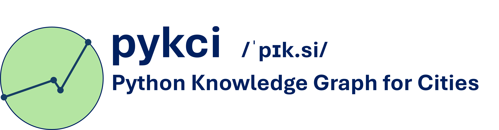

<p align="center">
  <picture>
    <source media="(prefers-color-scheme: dark)" srcset="resources/logo-dark-mode.png">
    <source media="(prefers-color-scheme: light)" srcset="resources/logo-light-mode.png">
    
  </picture>
</p>

<h1 align="center">pykci</h1>
<p align="center"><b>Python Knowledge Graph for Cities</b></p>

<p align="center">
  
  
  
  
  
  
  
</p>

<p align="center">
  <i>Ingest CityGML city models into a Neo4j graph, query them in natural language, and export them back.</i>
</p>

---

## What is pykci?

Cities publish their 3D models as **CityGML**, an XML-based OGC standard. **pykci** reads those files into a **Neo4j property graph**, where buildings, walls, roofs, trees, bridges, and tunnels become nodes and relationships you can query.

From the graph you can:

- **Ask questions in natural language** ("How many buildings are taller than 20 m near the harbour?") via a local or commercial LLM that generates Cypher.
- **View the city in 3D** in a browser (3D Tiles + CesiumJS) or explore the graph itself interactively.
- **Export back to CityGML.** The round-trip aims to be lossless: IDs, coordinate strings, and attributes are stored verbatim and re-emitted.

> **New to 3D city models?** CityGML describes a city's geometry together with semantic attributes (function, roof type, height, and so on). Representing it as a graph makes the relationships between objects - which surfaces belong to a building, which buildings are near each other - explicit and queryable.

pykci is described in the paper [*pykci: A Compact Urban Knowledge Graph for Semantic and Spatial Queries using LLMs*](https://arxiv.org/abs/2607.01605) (Nguyen, Arzoumanidis & Dehbi, 2026). If you use pykci in your research, please cite:

```bibtex
@misc{nguyen_pykci_2026,
      title={pykci: A Compact Urban Knowledge Graph for Semantic and Spatial Queries using LLMs},
      author={Huynh Duc An Son Nguyen and Lukas Arzoumanidis and Youness Dehbi},
      year={2026},
      eprint={2607.01605},
      archivePrefix={arXiv},
      primaryClass={cs.DB},
      url={https://arxiv.org/abs/2607.01605},
}
```

---

## Highlights

| | |
| --- | --- |
| 🏙️ **CityGML 2.0 coverage** | The 10 thematic modules with geometry (Building, Transportation, Vegetation, WaterBody, LandUse, CityFurniture, Relief, Bridge, Tunnel, CityObjectGroup), LoD 0–4, implicit geometry. |
| 🔁 **Lossless round-trip** | Ingest → graph → export. A census gate checks that elements, attributes, text nodes, and coordinate tokens are reproduced; verified across LoD0–4 and all modules (the Appearance module is excluded by design). |
| 🗣️ **Natural-language queries** | Model-agnostic LangChain layer: run a **local LLM** (Ollama) to keep data on-premise, or use **Claude** for harder spatial/semantic queries. |
| 🌐 **3D in the browser** | Exports OGC **3D Tiles 1.1**, including window/door openings cut as holes in walls, viewable in CesiumJS. |
| 🕸️ **Graph viewers** | Self-contained HTML: a 2D force-directed graph and a combined 3D-Tiles-plus-graph view, both with light/dark mode. |
| 📍 **Spatial features** | Neo4j Spatial R-tree index, `NEARBY_BUILDING` proximity edges, and GDS Louvain community detection. |
| 🗺️ **OpenStreetMap enrichment** | Optional non-destructive enrichment from `.osm.pbf`: building use, names, addresses, heights, roof shapes, POIs, land use, water, vegetation and the street network, matched to pykci features across 1:1/1:n/n:1/n:m footprints with full provenance ([OSM_INTEGRATION.md](OSM_INTEGRATION.md)). |
| 📊 **Benchmarked** | Holds all of Hamburg (6.93 GB CityGML, 388,267 buildings) in a graph **~6× smaller** than 3DCityKG's (15.2 M vs 89.5 M nodes). On a suite of 20 natural-language questions, every answerable question was answered correctly, with each query running **~2× to ~16× faster** than on 3DCityDB v5 (net of client startup, ~7× faster on average) with the **shortest query text length** (~290 vs ~970 chars compared to 3DCityDB v5) and the **fewest schema-discovery queries** (~2 vs ~7 consecutive queries for 3DCityKG). See [Benchmarks](#benchmarks). |

---

## Architecture

```text
                       input/citygml/*.gml
                               │
                               ▼
                       ingest_citygml.py
                               │
                               ▼
                    ┌──────────────────────┐
                    │   Neo4j graph store   │
                    │  bolt://localhost:7687│
                    └──────────┬───────────┘
                               │
   ┌───────────────┬───────────┼────────────────┬─────────────────────┐
   ▼               ▼           ▼                 ▼                     ▼
export_citygml  build_3dtiles  visualize_*    export_graph_html   query_ollama_full
   │               │           │                 │                  query_ollama_min
   ▼               ▼           ▼                 ▼                     │
output/citygml  output/3dtiles  output/html    output/html        (NL → Cypher answers)
 (lossless GML) (CesiumJS 3D)  (Three.js / CesiumJS / vis-network)
```

| | |
| --- | --- |
| **Graph store** | Local Neo4j (`bolt://localhost:7687`) with APOC, Spatial, GenAI, and GDS plugins |
| **Input** | CityGML 2.0, all LOD levels (LoD0–4), implicit geometry |
| **3D output** | OGC 3D Tiles 1.1 (GLB + `tileset.json`), viewable in CesiumJS |
| **Viewers** | Three.js (from a CSV of IDs) · vis-network (full graph) · CesiumJS (3D + graph overlay) |
| **NL queries** | LangChain → Cypher, model-agnostic - Ollama (private, on-premise) or Anthropic Claude (`ANTHROPIC_API_KEY`) |

---

## Quick start (Docker)

All services run via Docker Compose from the `docker/` directory.

### 1 · Neo4j only - ingestion and export

```bash
cd docker
docker compose up -d neo4j
```

Neo4j is ready when `http://localhost:7474` responds (health-check polls every 15 s). Then ingest a CityGML file:

```bash
python ingest_citygml.py input/citygml/yourfile.gml
```

### 2 · Neo4j + Ollama - ingestion and natural-language queries

```bash
cd docker
docker compose up -d neo4j ollama

# First run only - pull a model (pick one)
docker compose exec ollama ollama pull qwen2.5-coder:14b   # ~9 GB
docker compose exec ollama ollama pull qwen2.5-coder:7b    # ~4.7 GB

# Start an interactive query session
docker compose run --rm llm-query
```

### Reset to a fresh database

```bash
cd docker
docker compose down
docker volume rm docker_neo4j_data docker_neo4j_logs
docker compose up -d neo4j
```

### Remove everything (including the downloaded model)

```bash
cd docker
docker compose down -v
```

---

## Requirements

### Python dependencies

```bash
pip install lxml neo4j pyproj mapbox-earcut numpy
pip install shapely                                                        # required for ingest_osm.py; also cleans window/door holes in 3D Tiles
pip install langchain langchain-community langchain-ollama langchain-neo4j  # NL queries (local)
pip install langchain-anthropic                                            # NL queries (Claude)
```

For the Claude backend, set an API key: `export ANTHROPIC_API_KEY=sk-ant-...` (PowerShell: `$env:ANTHROPIC_API_KEY = "sk-ant-..."`).

**OpenStreetMap enrichment** ([`ingest_osm.py`](ingest_osm.py)) additionally needs **GDAL's `ogr2ogr` CLI** on your PATH (e.g. `brew install gdal` / `apt install gdal-bin`) plus `shapely` and `pyproj` (above) — the OGR Python binding is **not** required.

### Neo4j plugins

These plugins extend the database. Copy their JARs into Neo4j's `plugins/` directory (or use the provided `docker/Dockerfile.neo4j`, which bundles them automatically).

| Plugin | Used for | Bundled? |
| ------ | -------- | -------- |
| [neo4j-contrib/spatial](https://github.com/neo4j-contrib/spatial) | R-tree spatial index (`spatial.bbox`, `spatial.intersects`) | ✓ |
| [APOC](https://neo4j.com/docs/apoc/5/overview/) | Batch operations, collection utilities | ✓ |
| [Neo4j GenAI](https://neo4j.com/docs/genai/plugin/current/) | Vector embeddings for semantic similarity search | ✓ |
| [Graph Data Science](https://neo4j.com/docs/graph-data-science/current/) | Louvain community detection on the proximity graph | — download |

The **Graph Data Science** JAR is not bundled (its license restricts redistribution); download it from the link above into `docker/plugins/` before building the Neo4j image if you want Louvain community detection. All plugins are detected at runtime - scripts skip gracefully if a plugin is absent. Set `NEO4J_GENAI_KEY=<your-OpenAI-key>` before running `ingest_citygml.py` to populate building embeddings.

---

## Scripts

### 1 · Ingest CityGML → Neo4j

```bash
python ingest_citygml.py path/to/file.gml
```

Parses a CityGML 2.0 file and writes all supported modules into Neo4j. The script is **idempotent** - re-running merges into existing nodes via `MERGE … SET` without creating duplicates. Works for any CityGML dataset; CRS, codes, LOD level, and attribute names are all read from the file at runtime.

**Supported CityGML modules:** Building, Transportation (Road, Railway, Track, Square), Vegetation (SolitaryVegetationObject, PlantCover), WaterBody, LandUse, CityFurniture, Relief, Bridge, Tunnel, CityObjectGroup.

**After writing feature nodes the script also:**

- Registers all features in the **Neo4j Spatial R-tree** index (layer `features`)
- Creates a `building_embeddings` **vector index** and encodes `Building.description` via the GenAI plugin (requires `NEO4J_GENAI_KEY`)
- Creates **`NEARBY_BUILDING`** edges (100 m radius, R-tree accelerated)
- Runs **GDS Louvain** community detection and writes `community_id` onto each `Building` node

Output: nodes and relationships in Neo4j + `output/<stem>_summary.md`

### 1b · Enrich with OpenStreetMap (optional)

```bash
python ingest_osm.py input/osm/<city>.osm.pbf            # run after ingest_citygml.py
python ingest_osm.py input/osm/<city>.osm.pbf --buffer 10 --overlap-threshold 0.3
```

Enriches the graph with OpenStreetMap data over the same area. Reads the target `Dataset`'s CRS + bounding box from the graph, clips the `.osm.pbf` to that tile (+ buffer) and reprojects WGS84 → the dataset CRS. Adds one `(:OsmFeature)` node per OSM object (all tags + geometry, `osm_*` scalars, OSM building/landuse/water/vegetation/road/POI/furniture), links them to pykci features with `(:Building|:CityObject)-[:ENRICHED_BY {overlap_ratio, jaccard, is_primary, match_type}]->(:OsmFeature)` resolving the **1:1 / 1:n / n:1 / n:m** building-footprint correspondences via an overlap-graph + connected-component method, and attaches point POIs with `HAS_POI`. Indexed in a separate `osm_features` R-tree layer.

**Non-destructive & idempotent:** OSM never overwrites authoritative CityGML/ALKIS attributes (OSM values use the `osm_` prefix; the `OsmFeature` node + `ENRICHED_BY` edge are the provenance hint), and each run resets prior OSM data so it can be re-run with new parameters. Uses the `ogr2ogr` CLI (GDAL) + `shapely` + `pyproj`. See **[OSM_INTEGRATION.md](OSM_INTEGRATION.md)** for the full concept, matching strategy, and tuning.

Output: `OsmFeature` nodes + `ENRICHED_BY`/`HAS_POI` edges in Neo4j + `output/<stem>_osm_summary.md`

### 1c · Add street trees (optional)

```bash
python enrich_street_trees.py input/citygml/Strassenbaumkataster_20210901_Sommerbaeume.gml
python build_tree_tiles.py --out ../pykci-client/data/tiles/hamburg/trees \
    --texture-root input/citygml --align ../pykci-client/data/tiles/hamburg/tileset.json
```

Adds a street-tree cadastre (CityGML `SolitaryVegetationObject` with implicit geometry; Hamburg: 224,185 trees) as authoritative `CityObject`s. Each of the ~115 shared tree shapes is stored once as a `(:GeometryPrototype)` with its texture, and every tree's implicit geometry links to it with `HAS_PROTOTYPE` instead of copying ~615 triangles per tree. Trees get positions, crown bounding boxes and entries in the `features` R-tree; every step is idempotent. `build_tree_tiles.py` rebuilds the textured trees from the graph alone as GPU-instanced 3D Tiles 1.1, aligned with the city tileset. See **[STREET_TREES.md](STREET_TREES.md)**.

### 2 · Export Neo4j → CityGML

```bash
python export_citygml.py
```

Reconstructs a CityGML 2.0 file from the graph, covering all ingested modules. Geometry, bounding boxes, `creationDate`, `gen:stringAttribute` values (original CamelCase names preserved), `externalReference`, LOD solids, boundary surfaces, and terrain intersections are all restored.

Output: `output/citygml/<stem>_export.gml`

### 3 · Export CityGML → 3D Tiles

```bash
python build_3dtiles.py [--dataset <file.gml>] [--out <dir>]
```

Converts the graph's geometry (ingest first) to a 3D Tiles 1.1 dataset for browser visualisation; omit `--dataset` when the graph holds a single dataset. The CRS and geoid undulation are derived from the dataset's `srsName` automatically - no hardcoded EPSG codes. LoD3 **window/door openings stored as `gml:interior` rings are cut as holes** in the wall meshes (overlapping/touching openings resolved with `shapely` when installed) so they are not hidden behind solid walls.

Output:

```text
output/3dtiles/
├── tileset.json     # 3D Tiles root (dataset CRS → ECEF tile transform)
└── tiles/city.glb   # GLB: all feature modules, one mesh primitive per material
```

**To view in a browser:** serve the output directory over HTTP (3D Tiles will not load from `file://`) and point a CesiumJS viewer - e.g. the combined viewer from `visualize_graph_3d.py` - at `tileset.json`.

### 4 · Generate a 3D HTML viewer from a list of IDs

```bash
python visualize_buildings_3d.py ids.csv
python visualize_buildings_3d.py ids.csv --radius 100
python visualize_buildings_3d.py ids.csv --output output/html/my_view.html --title "HafenCity selection"
python visualize_buildings_3d.py ids.csv --ref-id DEHHALKA4IB000Cv --radius 100
```

Reads feature IDs from a CSV, queries Neo4j for LOD2 surface geometry (walls, roof, ground), and writes a **self-contained Three.js HTML file** that works directly from `file://` without a web server.

**CSV format** - one column named `gmlid`, `id`, `building_id`, or `fid` (auto-detected). Optional `role` column (`reference` / `neighbour` / `highlight`) controls colours. Optional `label` column sets the display name.

Output: `output/html/buildings_3d.html` (default) or the path given by `--output`.

**Features:**

- Actual LOD2 polygon geometry from Neo4j (walls, roof faces, ground)
- Orbit / zoom / pan controls (Three.js OrbitControls)
- Dashed radius circle and connector lines when `--radius` is set
- Hover tooltip with feature ID, description, and distance from reference
- Works for any CityGML dataset - no hardcoded coordinates

### 4b · Export the full property graph as an interactive HTML viewer

```bash
python export_graph_html.py
python export_graph_html.py --skip-geometry
python export_graph_html.py --limit 500
python export_graph_html.py --output output/html/mygraph.html
```

Queries all nodes and relationships from Neo4j and writes a **self-contained vis-network HTML file** that works from `file://` without a web server. By default every node and edge is exported; use `--skip-geometry` to hide geometry leaf nodes (GeometryRing, GeometryPolygon, etc.) when the graph is too large to render comfortably.

| Flag | Default | Effect |
| ---- | ------- | ------ |
| `--output <path>` | `output/html/graph_<timestamp>.html` | Custom output path |
| `--limit <N>` | none | Cap the number of nodes fetched |
| `--skip-geometry` | off | Exclude geometry leaf nodes |

**Features:**

- Force-directed layout (vis-network) with physics toggle
- Light / dark mode toggle (🌙 / ☀️ button)
- Left panel: label legend with per-label visibility toggle
- Right panel: full property list for any selected node or edge
- Search bar - matches node label or any property value and flies the camera to the first hit

### 4c · Combined 3D Tiles + graph viewer

```bash
# First serve the 3D Tiles (built by build_3dtiles.py)
cd output/3dtiles && python serve.py

# In a second terminal, generate the viewer
python visualize_graph_3d.py
python visualize_graph_3d.py --tileset-url http://localhost:8080/tileset.json
python visualize_graph_3d.py --opacity 0.4
python visualize_graph_3d.py --output output/html/graph_3d.html
```

Queries **every node and edge** in the Neo4j graph, transforms coordinates into WGS84 (with geoid undulation so nodes align vertically with the 3D tile geometry), and generates a **self-contained CesiumJS HTML file**.

| Flag | Default | Effect |
| ---- | ------- | ------ |
| `--tileset-url <url>` | `http://localhost:8080/tileset.json` | URL of the served tileset |
| `--opacity <0–1>` | `0.5` | Initial 3D Tiles transparency |
| `--output <path>` | `output/html/graph_3d_<timestamp>.html` | Output path |

#### Node placement

Nodes are positioned in 3D space according to two strategies:

**Spatial nodes** - nodes that own or reference geometry are placed at the centroid of that geometry.

| Node type | Position source | Altitude |
| --------- | --------------- | -------- |
| `Building` / `CityObject` | Precomputed `center_x` / `center_y` bbox centroid | `ground_z + measured_height / 2` |
| `BoundarySurface` | Average of all exterior-ring vertices | Ring centroid z |
| `GeometrySolid` | Average of all surface-member ring vertices | Ring centroid z + 6 m |
| `GeometryPolygon` | Average of exterior-ring vertices | Ring centroid z + 3 m |
| `GeometryRing` | Average of `pos_list` vertices | Ring centroid z − 3 m |
| `GeometryLineString` | Average of `pos_list` vertices | Vertex centroid z |
| `TerrainIntersection` | Average of all connected `GeometryLineString` vertices | Vertex centroid z |

When multiple node types share the same centroid (e.g. a surface with a single polygon and a single ring), each is shifted by a small deterministic XY jitter (2 m radius, derived from a hash of the node's element ID) so they remain distinguishable.

**Thematic / semantic nodes** - nodes with no own geometry are anchored to their related spatial nodes.

| Node type | Anchor | Altitude offset |
| --------- | ------ | --------------- |
| `BuildingFunction` | Average centroid of connected `Building` nodes | Building rooftop + 8 m |
| `RoofType` | Average centroid of connected `Building` nodes | Building rooftop + 5 m |
| `District` | Average centroid of all buildings in the district | Building rooftops + 80 m |
| `City` | Average centroid of all buildings in the city | Building rooftops + 150 m |
| `Dataset` | Average centroid of all buildings in the dataset | Building rooftops + 220 m |

#### Visual encoding

- **Node size** scales with hierarchy: `Dataset` / `City` (13–14 px) → `Building` (14 px) → `BoundarySurface` (7 px) → `GeometryRing` (4 px).
- **Node colour** is assigned per type; the left-panel legend shows all types and allows per-group visibility toggle.
- **Edges** - all relationships in the graph (excluding internal R-tree edges) are drawn as 3D polylines. Toggle with the *Edges* button.
- **Depth test disabled** on nodes - they are always visible and clickable even when occluded by 3D tile meshes.
- **Individual building highlight** on hover / click via `EXT_mesh_features` per-vertex feature IDs embedded in the GLB.

#### Other features

- 3D Tiles rendered semi-transparent (opacity slider) so graph elements show through the building models
- Right panel: full property list for any clicked node or building
- Node labels, edge labels, and edges each have an independent toggle button
- **Light / dark mode** toggle - light mode uses a warm beige basemap (CartoDB Positron, semi-transparent over a sandy globe base); dark mode uses CartoDB Dark Matter
- Camera positioned at the data extent on load; flies to the tileset once it finishes loading

### 4d · Scalable graph point-cloud tiles

```bash
python build_graph_pointcloud.py
python build_graph_pointcloud.py --building-tileset-url http://localhost:8080/tileset.json
python build_graph_pointcloud.py --max-per-tile 500 --geo-error-scale 20
python build_graph_pointcloud.py --output output/graph_tiles
```

Exports **every node and edge** in the Neo4j graph as an OGC **3D Tiles 1.0 point-cloud (`pnts`) quadtree** for browser visualisation that scales to large graphs - where `visualize_graph_3d.py` embeds the whole graph in one HTML file, this streams tiles on demand. Nodes are placed using the same spatial / aggregate strategy as section 4c and projected to WGS84 (with geoid undulation); the most important nodes (`Dataset` → `City` → `Building` → … → `GeometryRing`) stay in coarser tiles so they appear first as you zoom in. Edges are loaded from `edges.json` and drawn only when the camera is below 2 km altitude.

| Flag | Default | Effect |
| ---- | ------- | ------ |
| `--output <path>` | `output/graph_tiles` | Output directory |
| `--building-tileset-url <url>` | `http://localhost:8080/tileset.json` | Optional building 3D Tiles overlay shown alongside the graph |
| `--max-per-tile <N>` | `500` | Max nodes per quadtree tile before it splits |
| `--max-depth <N>` | `8` | Max quadtree depth |
| `--geo-error-scale <N>` | `20` | `geometricError = tile_diagonal_m / scale` |

Output:

```text
output/graph_tiles/
├── tileset.json     # 3D Tiles quadtree manifest
├── nodes.json       # node properties for the property panel
├── edges.json       # graph edges (drawn when the camera is close)
├── viewer.html      # CesiumJS viewer
├── serve.py         # CORS-aware HTTP server (port 8081)
└── tiles/           # *.pnts tile files
```

**To view in a browser:**

```bash
cd output/graph_tiles && python serve.py        # graph tiles at :8081
cd output/3dtiles && python serve.py             # buildings at :8080 (optional overlay)
# then open http://localhost:8081/viewer.html
```

### 4e · 2D footprint map coloured by predicted roof material

```bash
python export_roofmat_footprints.py
python export_roofmat_footprints.py --dataset <file.gml>
python export_roofmat_footprints.py --basemap osm
python export_roofmat_footprints.py --output output/html/my_roofmap.html
```

Reads each building's `GroundSurface` footprint and its ML-predicted `predictedroofmaterial` straight from Neo4j (no GML needed), reprojects the footprints to WGS84 (CRS derived from the dataset's `srsName`), and writes a **self-contained Leaflet HTML map** with polygons coloured by roof material, an interactive legend with per-class counts, and per-building popups (id, predicted roof, height). The palette matches `build_3dtiles.py --color-by roofmat` (the `soft` teaser palette) so the 2D map and the 3D teaser read as one system. Provenance-aware: the popup labels the material as *predicted*, and buildings without a prediction get a neutral "no prediction" coat rather than being dropped. Omit `--dataset` when the graph holds a single dataset.

| Flag | Default | Effect |
| ---- | ------- | ------ |
| `--dataset <name>` | the only dataset present | Which dataset's buildings to map |
| `--output <path>` | `output/html/roofmat_footprints.html` | Output HTML path |
| `--basemap <voyager\|osm>` | `voyager` | Basemap tiles |
| `--source-crs <EPSG:N>` | derived from `Dataset.crs` | Override footprint CRS |

Output: `output/html/roofmat_footprints.html` - open directly in a browser (everything except the basemap tiles is inlined).

### 5 · Natural-language queries

```bash
python db-llm/query_ollama_full.py
python db-llm/query_ollama_full.py --model qwen2.5-coder:7b
```

Interactive CLI that translates plain-English questions into Cypher via `GraphCypherQAChain`. Neo4j must be running. The query layer is **model-agnostic**:

- **Local (Ollama)** - default; runs entirely on-premise, keeping data private. Requires Ollama at `http://localhost:11434`. Best for routine queries.
- **Commercial (Claude)** - swap the LLM object (`ChatOllama` → `ChatAnthropic`) for the most demanding spatial/semantic reasoning. Requires `ANTHROPIC_API_KEY`. Note: the schema, question, and returned rows leave the local machine - prefer the local backend for privacy-sensitive data.

#### Minimal-context variant (small models on a laptop)

```bash
python db-llm/query_ollama_min.py --model qwen2.5-coder:7b
python db-llm/query_ollama_min.py --ctx 16384 --summarize
```

`query_ollama_min.py` is a lean alternative tuned for small open models on a laptop with no GPU (e.g. Apple Silicon). Instead of injecting all of `GRAPH.md` + `CYPHER.md` (~24k tokens) every call, it embeds a hand-distilled ~850-token schema + Cypher cheat-sheet (`MINIMAL_CONTEXT`) directly in the script, so the context window (`--ctx`, default 8192) stays small and the KV cache fits in RAM - no swapping, much faster. It makes one LLM call per question (add `--summarize` for a plain-English answer), and strips `<think>…</think>` blocks and ``` fences before running the query. Prefer a tool/code model such as `qwen2.5-coder:7b`; `deepseek-r1` adds `<think>` overhead and weaker current-Cypher accuracy.

---

## Tools

The `tools/` directory holds standalone utilities that are handy alongside pykci but are **not** part of the core ingest → graph → export pipeline (they don't touch Neo4j).

### CityGML → GeoJSON building footprints

```bash
py tools/extract_citygml_building_footprints.py input/citygml/FZK-Haus/FZK-Haus-LoD2-KIT-IAI-KHH-B36-V1.gml
py tools/extract_citygml_building_footprints.py input/citygml/nyc          # a whole folder, recursively
py tools/extract_citygml_building_footprints.py input/citygml/hamburg --keep-source-crs
```

Extracts one ground-level footprint polygon per building and writes a single GeoJSON `FeatureCollection` to `output/geojson/`, with each building's `gml:id` in `properties.gml_id`. The footprint is taken from `bldg:lod0FootPrint`, else `bldg:GroundSurface`, else the lowest near-horizontal polygon (an LoD1 extruded-block fallback). Element matching is by local name, so **CityGML 1.0 / 2.0 / 3.0** all work with one code path, and it **streams** (`lxml.iterparse`) so multi-GB city files parse in bounded memory.

By default every footprint is **reprojected to WGS84** so datasets from different cities line up in one file — GML axis order is normalised and non-metric heights (e.g. NYC's EPSG:2263 feet) are scaled to metres, reusing the same `srsName` resolution as `ingest_citygml.py`. The resolved `source_crs` and `target_crs` are recorded as top-level members of the GeoJSON. Use `--keep-source-crs` for raw source coordinates or `--target-crs EPSG:N` to pick another target. See **[`tools/CITYGML_BUILDING_FOOTPRINT_EXTRACTION.md`](tools/CITYGML_BUILDING_FOOTPRINT_EXTRACTION.md)** for the full rationale.

---

## Graph model

### CityGML 2.0 modules

CityGML 2.0 defines 14 modules. 10 are ingested; the remaining 4 are not stored as graph nodes.

| Module | Neo4j label(s) | Geometry style | Supported |
| ------ | -------------- | -------------- | --------- |
| Building | `Building` | Solid + BoundarySurfaces | ✓ |
| Transportation | `Road` `Railway` `Track` `Square` `TransportationComplex` | lod*MultiSurface | ✓ |
| Vegetation | `SolitaryVegetationObject` `PlantCover` | lod*Geometry / ImplicitGeometry | ✓ |
| WaterBody | `WaterBody` | Solid or lod*MultiSurface + BoundarySurfaces | ✓ |
| LandUse | `LandUse` | lod*MultiSurface | ✓ |
| CityFurniture | `CityFurniture` | lod*Geometry / ImplicitGeometry | ✓ |
| Relief | `ReliefFeature` | TIN / MassPoint / Breakline | ✓ |
| Bridge | `Bridge` | Solid or lod*MultiSurface + BoundarySurfaces | ✓ |
| Tunnel | `Tunnel` | Solid or lod*MultiSurface + BoundarySurfaces | ✓ |
| CityObjectGroup | `CityObjectGroup` | lod*Geometry | ✓ |
| Appearance | - | - | - |
| Generics | - | gen:*Attribute values stored on feature nodes | - |
| TexturedSurface | - | deprecated in CityGML 2.0 | - |
| Core | - | abstract base types, not stored directly | - |

All concrete feature types (`Building` + all `CityObject` subtypes) that carry a `gml:boundedBy` envelope are registered in the **Neo4j Spatial R-tree** (layer `features`) after ingestion, enabling `spatial.bbox`, `spatial.intersects`, and `spatial.withinDistance` queries across the entire dataset.

**OpenStreetMap enrichment (optional).** After CityGML ingestion, [`ingest_osm.py`](ingest_osm.py) adds `(:OsmFeature)` nodes linked to pykci features via `ENRICHED_BY` (and `HAS_POI` for point POIs), with OSM-derived attributes kept under an `osm_` prefix so authoritative CityGML/ALKIS values are never overwritten. OSM features are indexed in a separate `osm_features` R-tree layer. See [OSM_INTEGRATION.md](OSM_INTEGRATION.md).

**Multi-source & provenance (design principle).** pykci is a *multi-source* graph spanning a spectrum of trust levels — authoritative CityGML/ALKIS, crowd-sourced OSM, ML-predicted (e.g. roof materials), and reconstructed (LoD3). The origin and reliability of every fact stays explicit and queryable: every node/edge carries a `source`, derived values are namespaced (never overwriting authoritative keys), predictions and fusion links carry confidence, and partial coverage is flagged so *absence* is distinguishable from a *negative*. Any new mapping function must decide and store provenance before writing — see the *Provenance & Multi-Source Design Principle* in [GRAPH.md](GRAPH.md).

### Schema

All non-Building feature nodes carry two labels: the module-specific label (e.g. `Bridge`) and the shared base label `CityObject`. Query either way:

```cypher
MATCH (n:Bridge) ...                          // requires APOC at ingest time
MATCH (n:CityObject {feature_type: 'Bridge'}) // always works
```

Most nodes also carry an extra `Entity` label backed by an `Entity(id)` index. It is internal plumbing: it lets the ingester's generic edge-creation lookups (`MATCH (a:Entity {id: …})`, where the endpoint label isn't known at write time) hit an index instead of scanning all nodes. Ignore `Entity` in your own queries; the high-cardinality leaf nodes (`GeometryRing`, `GeometryLineString`, `TerrainIntersection`, `Dataset`) don't carry it.

```text
── Spatial context ──────────────────────────────────────────────────────────────
(Dataset)                  -[:COVERS]->                         (District)
(District)                 -[:PART_OF]->                        (City)

── Building module ──────────────────────────────────────────────────────────────
(Building)                 -[:PART_OF]->                        (Dataset)
(Building)                 -[:LOCATED_IN]->                     (District)
(Building)                 -[:HAS_FUNCTION]->                   (BuildingFunction)
(Building)                 -[:HAS_ROOF_TYPE]->                  (RoofType)
(Building)                 -[:HAS_LOD_SOLID]->                  (GeometrySolid)
(Building)                 -[:HAS_BOUNDARY {order}]->           (BoundarySurface)
(Building)                 -[:HAS_TERRAIN_INTERSECTION]->       (TerrainIntersection)
(Building)                 -[:NEARBY_BUILDING {distance_m}]->   (Building)

── Transportation module ────────────────────────────────────────────────────────
(Road)                     -[:PART_OF]->                        (Dataset)
(Railway)                  -[:PART_OF]->                        (Dataset)
(Track)                    -[:PART_OF]->                        (Dataset)
(Square)                   -[:PART_OF]->                        (Dataset)
(TransportationComplex)    -[:PART_OF]->                        (Dataset)
(Road|Railway|Track|Square|TransportationComplex) -[:HAS_LOD_SURFACE {lod}]-> (GeometryMultiSurface)

── Vegetation module ────────────────────────────────────────────────────────────
(SolitaryVegetationObject) -[:PART_OF]->                        (Dataset)
(PlantCover)               -[:PART_OF]->                        (Dataset)
(SolitaryVegetationObject|PlantCover) -[:HAS_LOD_SURFACE {lod}]-> (GeometryMultiSurface)

── WaterBody module ─────────────────────────────────────────────────────────────
(WaterBody)                -[:PART_OF]->                        (Dataset)
(WaterBody)                -[:HAS_LOD_SOLID]->                  (GeometrySolid)
(WaterBody)                -[:HAS_BOUNDARY {order}]->           (BoundarySurface)

── LandUse module ───────────────────────────────────────────────────────────────
(LandUse)                  -[:PART_OF]->                        (Dataset)
(LandUse)                  -[:HAS_LOD_SURFACE {lod}]->          (GeometryMultiSurface)

── CityFurniture module ─────────────────────────────────────────────────────────
(CityFurniture)            -[:PART_OF]->                        (Dataset)
(CityFurniture)            -[:HAS_LOD_SURFACE {lod}]->          (GeometryMultiSurface)

── Relief module ────────────────────────────────────────────────────────────────
(ReliefFeature)            -[:PART_OF]->                        (Dataset)
(ReliefFeature)            -[:HAS_LOD_SURFACE {lod}]->          (GeometryMultiSurface)

── Bridge module ────────────────────────────────────────────────────────────────
(Bridge)                   -[:PART_OF]->                        (Dataset)
(Bridge)                   -[:HAS_LOD_SOLID]->                  (GeometrySolid)
(Bridge)                   -[:HAS_BOUNDARY {order}]->           (BoundarySurface)

── Tunnel module ────────────────────────────────────────────────────────────────
(Tunnel)                   -[:PART_OF]->                        (Dataset)
(Tunnel)                   -[:HAS_LOD_SOLID]->                  (GeometrySolid)
(Tunnel)                   -[:HAS_BOUNDARY {order}]->           (BoundarySurface)

── CityObjectGroup module ───────────────────────────────────────────────────────
(CityObjectGroup)          -[:PART_OF]->                        (Dataset)
(CityObjectGroup)          -[:HAS_LOD_SURFACE {lod}]->          (GeometryMultiSurface)

── Geometry (shared by all feature types) ───────────────────────────────────────
(GeometrySolid)            -[:HAS_SURFACE_MEMBER {order}]->     (GeometryPolygon)
(GeometryMultiSurface)     -[:HAS_SURFACE_MEMBER {order}]->     (GeometryPolygon)
(BoundarySurface)          -[:HAS_POLYGON {order}]->            (GeometryPolygon)
(GeometryPolygon)          -[:HAS_EXTERIOR_RING]->              (GeometryRing)
(GeometryPolygon)          -[:HAS_INTERIOR_RING {ring_index}]-> (GeometryRing)
(TerrainIntersection)      -[:HAS_LINE {order}]->               (GeometryLineString)
```

The graph aims to be **lossless**: `gen:*Attribute` values, `gml:id` values, and coordinate strings are stored verbatim so the source CityGML can be reconstructed. A census gate verifies this (the Appearance module is excluded by design).

---

## Neo4j Browser

Open `http://localhost:7474` to explore the graph visually.

```cypher
// Overview of all node types and counts
MATCH (n) RETURN labels(n)[0] AS label, count(n) AS count ORDER BY count DESC

// All buildings with function and height
MATCH (b:Building)-[:HAS_FUNCTION]->(f:BuildingFunction)
RETURN b.id, b.measured_height, f.name ORDER BY b.measured_height DESC

// All city objects by module in a dataset
MATCH (n:CityObject)-[:PART_OF]->(d:Dataset)
RETURN d.name AS dataset, n.feature_type AS type, count(n) AS count
ORDER BY dataset, count DESC

// Full geometry of one building
MATCH (b:Building {id: "<building-gml-id>"})
      -[:HAS_BOUNDARY]->(s:BoundarySurface)
      -[:HAS_POLYGON]->(p:GeometryPolygon)
      -[:HAS_EXTERIOR_RING]->(r:GeometryRing)
RETURN s.surface_type, p.id, r.pos_list
ORDER BY s.surface_type

// Buildings with flat roofs (ALKIS roofType code 1000)
MATCH (b:Building)-[:HAS_ROOF_TYPE]->(rt:RoofType {code: "1000"})
RETURN b.id, b.measured_height ORDER BY b.measured_height DESC

// Spatial R-tree: all features within a bounding rectangle (dataset CRS coordinates)
CALL spatial.bbox('features',
     {x: <min_x>, y: <min_y>},
     {x: <max_x>, y: <max_y>}) YIELD node
RETURN node.id, labels(node) AS types,
       coalesce(node.feature_type, 'Building') AS feature_type,
       node.measured_height AS height
ORDER BY height DESC

// Vegetation: trees with world-space position (implicit geometry)
MATCH (v:SolitaryVegetationObject)-[:HAS_LOD_SURFACE]->(ms:GeometryMultiSurface)
RETURN v.id, v.species, ms.reference_point AS position, ms.transformation_matrix AS transform

// NEARBY_BUILDING: neighbours of one building within 100 m
MATCH (a:Building {id: "<building-gml-id>"})-[r:NEARBY_BUILDING]-(b:Building)
RETURN b.id, r.distance_m ORDER BY r.distance_m

// GDS community detection results
MATCH (b:Building) WHERE b.community_id IS NOT NULL
RETURN b.community_id AS community, count(b) AS members,
       round(avg(b.measured_height) * 10) / 10 AS avg_height_m
ORDER BY members DESC

// GenAI semantic search (requires NEO4J_GENAI_KEY and populated embeddings)
CALL genai.vector.encode('<query text>', 'OpenAI', {token: $api_key}) YIELD vector AS qv
CALL db.index.vector.queryNodes('building_embeddings', 10, qv) YIELD node AS b, score
RETURN b.id, b.description, score ORDER BY score DESC
```

---

## Benchmarks

pykci was compared with **3DCityKG** (Neo4j) and **3DCityDB v5** (PostGIS) on the **6.93 GB Hamburg LoD2** dataset, under the same 8-core / 20 GB Docker envelope (wall-clock time averaged over 3 runs).

| | pykci | 3DCityKG | 3DCityDB v5 |
| --- | --- | --- | --- |
| Graph size | 15.2 M nodes / 21.3 M edges | ~5.9× nodes / ~4.4× edges | relational (not a graph) |
| Spatial index | R-tree persisted | R-tree not persisted at this scale | PostGIS spatial index |
| Mapping time | slower than 3DCityDB | - | fastest of the three |
| Net query time (mean, 18 NL questions) | **~0.37 s** (fastest) | ~2.10 s | ~2.62 s |
| Query compactness (mean length) | **~290 chars**, self-contained | ~460 chars (max ~1060) | ~230 chars + ~745-char shared CTE |
| Schema-discovery queries needed | **~2** | ~7 | ~3 |

In this run, pykci produced the smallest of the two graphs and retained its R-tree, while 3DCityDB was the fastest to load. On the query side, the same 20 natural-language questions (10 citizen, 10 expert) were answered on all three databases: all returned identical, correct answers, but pykci's condensed domain schema made its queries the fastest to run (net of client startup) and the most compact to author: building attributes are direct node properties, so no multi-hop traversals (3DCityKG) or property-pivot CTEs (3DCityDB) are needed. These numbers are from a single hardware and dataset configuration; treat them as indicative rather than definitive. Full methodology, raw numbers, and reproduction steps: [`eval/tool_comparison/comparison_2026-06-19.md`](eval/tool_comparison/comparison_2026-06-19.md) (mapping) and [`eval/tool_comparison/queries/QUERY_BENCHMARK.md`](eval/tool_comparison/queries/QUERY_BENCHMARK.md) (querying), reproduce with [`run_benchmark.sh`](eval/tool_comparison/run_benchmark.sh).

---

## File layout

```text
pykci/
├── input/
│   ├── citygml/          ← place *.gml files here (read-only)
│   └── osm/              ← place *.osm.pbf files here (read-only)
├── output/
│   ├── citygml/          ← exported GML files
│   ├── 3dtiles/          ← tileset.json, tiles/city.glb, serve.py
│   ├── graph_tiles/      ← graph point-cloud tileset + viewer.html, serve.py
│   ├── geojson/          ← exported GeoJSON (e.g. building footprints from tools/)
│   ├── html/             ← standalone HTML exports (maps, viewers, reports)
│   └── stats/            ← census JSON + round-trip summaries
├── db-llm/               ← LangChain + Ollama query interface
│   ├── query_ollama_full.py  ← full-context NL→Cypher (GraphCypherQAChain)
│   └── query_ollama_min.py   ← minimal-context NL→Cypher for small/laptop models
├── tools/                ← miscellaneous standalone utilities (not part of the core pipeline)
│   ├── extract_citygml_building_footprints.py  ← CityGML → GeoJSON building footprints
│   └── CITYGML_BUILDING_FOOTPRINT_EXTRACTION.md ← its design rationale
├── docker/               ← Docker Compose for Neo4j + Ollama + query container
│   └── Dockerfile.ingest ← containerized pykci ingest (used by the benchmark)
├── eval/                 ← QA harness: round-trip fidelity + GML inventory
│   └── tool_comparison/  ← pykci vs 3DCityKG vs 3DCityDB benchmark (report + run_benchmark.sh)
├── resources/            ← project logo and brand assets
├── ingest_citygml.py     ← CityGML → Neo4j
├── ingest_osm.py         ← OpenStreetMap → Neo4j enrichment
├── enrich_street_trees.py ← street-tree cadastre → Neo4j (implicit geometry, prototypes)
├── build_tree_tiles.py   ← street trees in Neo4j → instanced, textured 3D Tiles
├── export_citygml.py     ← Neo4j → CityGML
├── build_3dtiles.py      ← CityGML → 3D Tiles
├── build_graph_pointcloud.py  ← Neo4j graph → 3D Tiles point-cloud
├── export_roofmat_footprints.py  ← Neo4j → 2D footprint map (predicted roof material)
├── GRAPH.md              ← Full graph schema, Cypher rules, ALKIS codes
├── OSM_INTEGRATION.md    ← OSM enrichment concept, matching & schema
├── STREET_TREES.md       ← street trees: input, graph model, tiles
├── CYPHER.md             ← Cypher 25 + Neo4j Spatial reference
└── README.md
```

---

## Reference docs

| File | Audience | Contents |
| ---- | -------- | -------- |
| [`GRAPH.md`](GRAPH.md) | Agents / developers | Full graph schema, ingestion rules, ALKIS codes, Cypher examples |
| [`OSM_INTEGRATION.md`](OSM_INTEGRATION.md) | Agents / developers | OSM enrichment: data model, semantic mapping, 1:1/1:n/n:1/n:m footprint matching, provenance schema, `ingest_osm.py` code map |
| [`STREET_TREES.md`](STREET_TREES.md) | Agents / developers | Street trees: CityGML implicit geometry, prototype storage, graph model, Cypher, instanced 3D Tiles |
| [`CYPHER.md`](CYPHER.md) | Agents / LLM (injected) | Cypher 25 + Neo4j Spatial plugin reference |
| [`tools/CITYGML_BUILDING_FOOTPRINT_EXTRACTION.md`](tools/CITYGML_BUILDING_FOOTPRINT_EXTRACTION.md) | Developers | Footprint → GeoJSON tool: footprint-selection priority, CRS/axis-order handling, version-agnostic parsing, streaming |
| [`eval/tool_comparison/comparison_2026-06-19.md`](eval/tool_comparison/comparison_2026-06-19.md) | Developers / reviewers | Mapping-time & database benchmark: pykci vs 3DCityKG vs 3DCityDB v5. Reproduce with [`run_benchmark.sh`](eval/tool_comparison/run_benchmark.sh) |

---

## License

Released under the [MIT License](LICENSE). Sample CityGML datasets, CityGML codelists/XSDs, and the bundled Neo4j plugin JARs are the property of their respective authors and remain under their own licenses.

---

<p align="center">
  <sub><b>pykci</b> · Python Knowledge Graph for Cities · CityGML → Neo4j → 3D &amp; natural language</sub>
</p>
